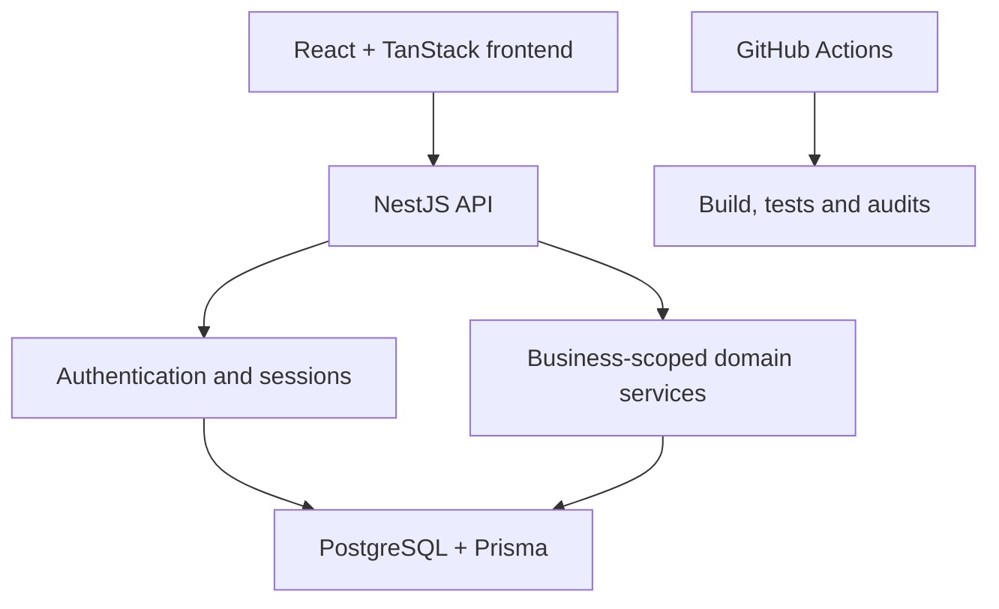
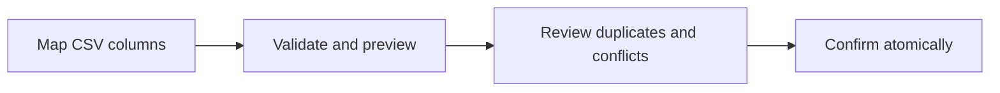

# Ledger Flow

Ledger Flow is a production-engineered V1 for secure, multi-tenant financial record management. It is designed for small businesses that need reliable transaction imports, workspace-based access, cash-movement reporting, transaction classification, and money-owed tracking.

This public repository is a recruiter-facing engineering case study. The complete application source is maintained privately to protect the product while allowing reviewers to understand the problem, architecture, technical decisions, testing approach, and current limitations.

## What I built

- Public account registration with email verification and bot protection
- Short-lived access tokens with rotating HTTP-only refresh sessions
- Password reset, login lockout, session revocation, and account deactivation
- Multi-tenant business workspaces with owner, administrator, bookkeeper, and viewer roles
- Expiring, single-use workspace invitations
- PostgreSQL-backed dashboard totals and weekly cash-movement reporting
- Reviewable CSV imports with mapping, validation, deduplication, conflict handling, and atomic confirmation
- Business/personal and category classification for transactions
- Receivables, payables, partial settlements, cancellation, and database integrity guards
- JSON data export and security-relevant audit events
- Health endpoints, structured logs, graceful shutdown, migrations, cleanup jobs, and Docker support
- Automated unit, integration, and end-to-end coverage in GitHub Actions

## Architecture

Every business-scoped request is checked against workspace membership. Mutating operations also enforce the member's role. Sensitive financial writes use database transactions and integrity constraints instead of relying only on interface validation.

## Core import flow

The confirmation step re-evaluates the data against the live database. Matching content without a reliable reference is treated as uncertain and requires a human decision. Reused references with incompatible values are surfaced as conflicts rather than silently overwritten.

## Important engineering decisions

| Decision | Reason |
| --- | --- |
| Return `404` for inaccessible workspaces | Avoid revealing whether another business exists |
| Rotate refresh sessions | Limit the usefulness of stolen session material |
| Require explicit import decisions | Avoid silently discarding legitimate financial records |
| Re-check rows during confirmation | Protect against changes between preview and save |
| Use transactions and database guards | Preserve correctness during failures and concurrent requests |
| Call the dashboard metric “net cash movement” | Avoid presenting cash movement as accounting profit |

## Difficult bugs resolved

- Recovered safely from a concurrent unique-constraint race by rolling back to a savepoint before applying the fallback path.
- Made import concurrency tests deterministic instead of relying on timing-sensitive behaviour.
- Corrected build/test configuration problems involving source roots and test-path matching.
- Replaced demonstration dashboard figures with PostgreSQL-backed calculations.
- Added settlement and payment-direction guards so invalid financial states are rejected at the database boundary.

## Verification

The completed V1 was verified through a continuous-integration pipeline covering:

- Frontend and API production builds
- Static type and lint checks
- Unit tests for normalisation, deduplication, permissions, and domain rules
- PostgreSQL-backed integration and end-to-end tests
- Deterministic concurrency and settlement-integrity tests
- Production dependency audits

The final public-source revision passed CI before the complete application repository was made private.

## Technology

| Area | Tools |
| --- | --- |
| Frontend | React, TypeScript, TanStack Router and Query, Tailwind CSS |
| API | NestJS, TypeScript, Zod, JWT, bcrypt |
| Data | PostgreSQL, Prisma, parameterised SQL |
| Delivery | Docker, GitHub Actions, migrations, health checks, structured logging |
| Testing | Jest, Supertest, PostgreSQL integration tests |

## Current boundaries

Ledger Flow is a completed, production-engineered V1, but it is not currently operated as a live financial service. Before accepting real financial data, it still requires:

- Managed PostgreSQL with tested backups and restoration procedures
- Production SMTP and Turnstile configuration
- TLS, secret management, monitoring, alerting, and incident procedures
- Documented retention, deletion, privacy, and access-review processes
- Legal and regulatory review appropriate to its deployment market
- A controlled launch and operational load testing

## My role

I owned the product scope and full-stack engineering work, including the data model, APIs, access controls, CSV import contract, financial integrity rules, user flows, tests, CI workflow, and deployment preparation. AI tools assisted parts of development; I reviewed, integrated, tested, and revised the implementation around the product and correctness requirements.

## Discussion

I can walk through the architecture, security model, import algorithm, race-condition fix, testing strategy, current limitations, and the production launch plan during an interview.

## Copyright

Copyright © 2026 Sang Enock Kipyegon. All rights reserved. This repository provides documentation for review and does not grant permission to reproduce or commercialise the Ledger Flow application.
